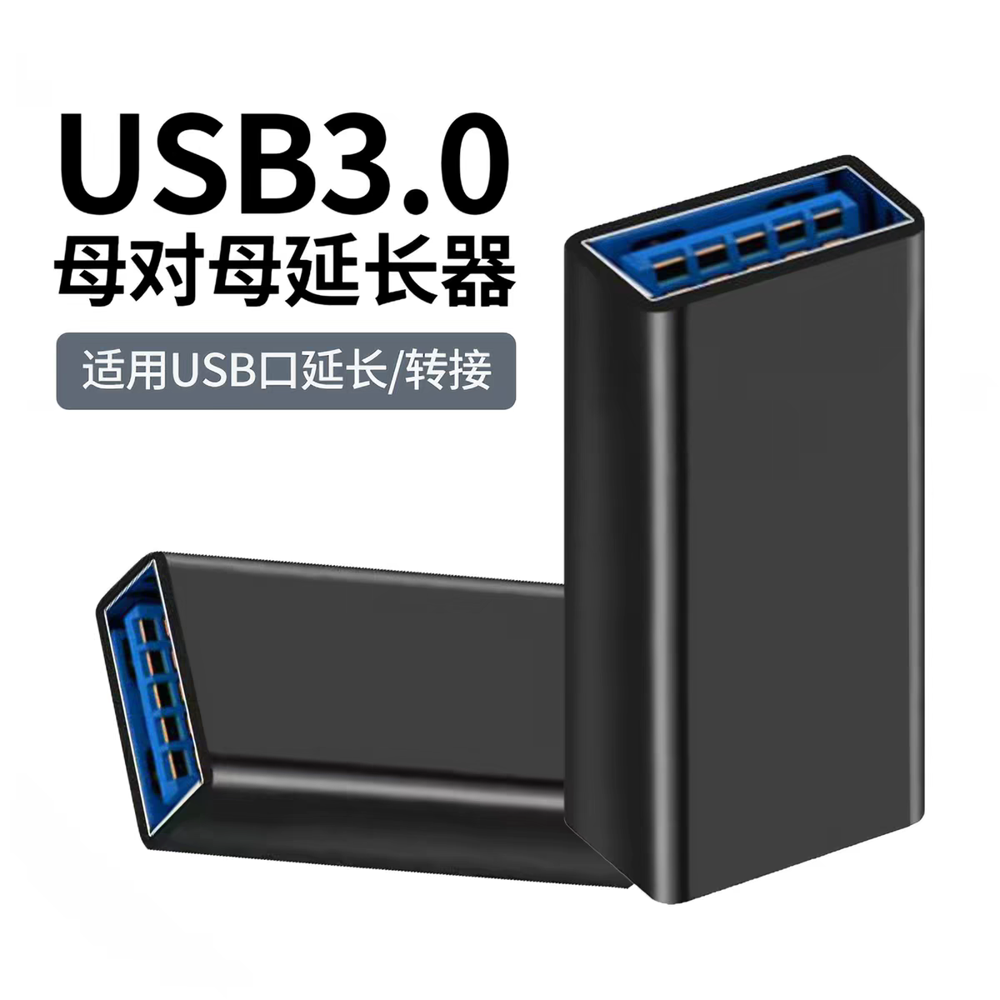
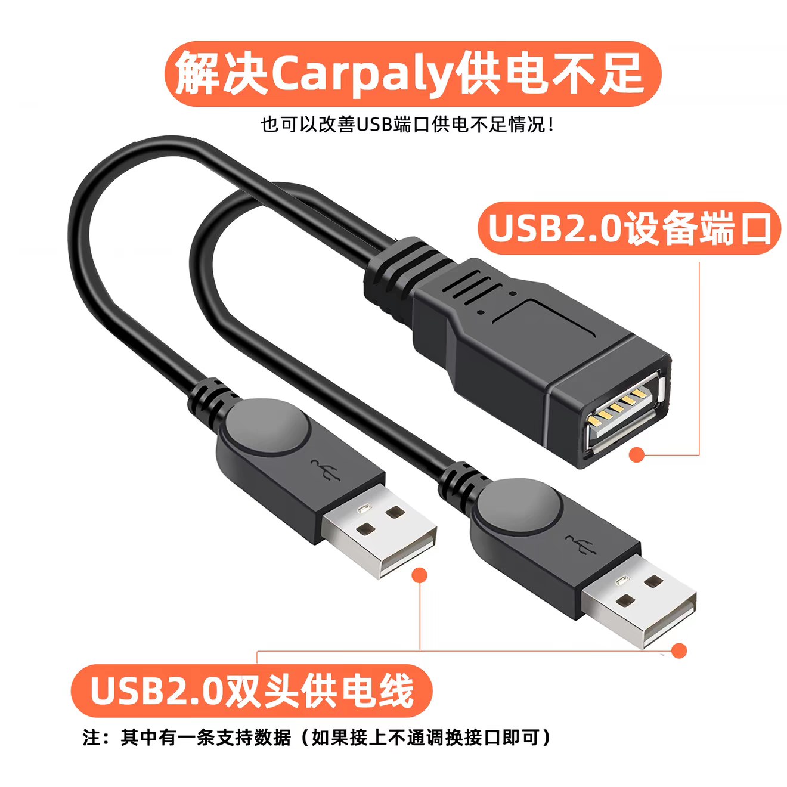

## 维护

### eMMC寿命查看

使用如下命令可查看eMMC寿命损耗：

```bash
cat /sys/class/mmc_host/mmc0/mmc0\:0001/life_time
cat /sys/class/mmc_host/mmc0/mmc0\:0001/pre_eol_info
```

其中`life_time`表示已消耗的寿命百分比，它有两个16进制数，第一个值代表 SLC 类型存储区域的寿命估算，第二个值代表 MLC 类型存储区域的寿命估算。正常情况下这两个值的范围是`0x01 - 0x0B`，`0x01`表示已消耗0% - 10%，`0x02`表示已消耗10% - 20%，以 10% 为步长。`0x0B`表示**已超出最大估计寿命**，`0x00`表示**未定义（不支持该功能）**。

`pre_eol_info` 表示的是 eMMC 内部**预留块（Reserved Blocks）** 的消耗情况。预留块是芯片出厂时保留的备用存储单元，用于替换在使用中产生的坏块。他也是一个16进制数字，`0x01` 定义为 “Normal”，意味着已消耗的预留块不足总量的 80%，备用资源池依然健康；`0x02`定义为 “Warning”，表示预留块消耗 ≥ 80%；`0x03`定义为“Urgent”，表示预留块消耗 ≥ 90%。

### 时间日期设置

使用如下命令设置时区：

```bash
timedatectl set-timezone Asia/Shanghai
```

使用如下命令更新系统时间：

```
date -s "2026-10-20 14:30:00"
```

### USB角色切换

```bash
# 1. 查看当前 USB 角色（默认输出 gadget）
cat /sys/bus/platform/devices/ci_hdrc.0/role

# 2. 切换为 USB 主机模式（外接 U 盘）
echo host > /sys/bus/platform/devices/ci_hdrc.0/role

# 3. 切回从机模式（恢复电脑 USB 网卡与 ADB）
echo gadget > /sys/bus/platform/devices/ci_hdrc.0/role
```

在部分内核版本中，`role`文件也会同时映射在 `/sys/class/usb_role/ci_hdrc.0-role-switch/role`。你可以随时运行 `find /sys -name "*role*"` 查看系统中所有可用的角色控制节点。

### 插入USB外设

棒子本身不具备供电能力，并且只有一个公口，因此要插入USB外设，至少需要一个USB双母转接头把棒子的公口转换成母口，以及能够同时给主机和从机供电的USB线。

USB双母转接头参考图片如下，将棒子插入其中任意一端即可。



同时给主机和从机供电的USB线有两种选择，一种是有独立供电口但没有做供电隔离的USB拓展坞，它们的供电口插上后会给主机供电。这种拓展坞一般都是比较劣质的杂牌或者贴牌货，因为标准的USB协议是不会给主机供电的。我手上的一个联想的贴牌拓展坞就是这样，而绿联等正规品牌一般不会有这种效果。使用时，把拓展坞的公口插入双母转接头另一端，母口插入U盘等设备，再给拓展坞接上供电即可。

另一种是USB一母二公延长线，如下图所示。其中一个公口是供电线；另外两个口一公一母，数据供电都有。这种线一般只有简单的焊接，所以也会同时给主机和从机供电。使用时，把USB一母二公延长线的数据公口插入双母转接头另一端，母口插入U盘等设备即可。



### MT7601U网卡驱动问题

如果需要使用MT7601U USB网卡，但是设备无法正常驱动，如果`dmesg`输出如下错误码：

```
[  507.177134] mt7601u 1-1:1.0: Direct firmware load for mt7601u.bin failed with error -2
[  507.182090] mt7601u 1-1:1.0: probe with driver mt7601u failed with error -2
```

说明缺少固件，需要安装mediatek的固件：

```bash
printf "\ndeb https://mirrors.tuna.tsinghua.edu.cn/debian bookworm-backports main non-free-firmware\n" >> /etc/apt/sources.list
apt update
apt install firmware-mediatek 
```

如果`dmesg`输出如下错误码：

```
[  484.240992] mt7601u 1-1:1.0: ASIC revision: 76010001 MAC revision: 76010500
[  484.243756] mt7601u 1-1:1.0: Firmware Version: 0.1.00 Build: 7640 Build time: 201302052146____
[  487.807444] mt7601u 1-1:1.0: Vendor request req:07 off:09a8 failed:-110
[  491.007678] mt7601u 1-1:1.0: Vendor request req:02 off:09a8 failed:-110
[  494.207483] mt7601u 1-1:1.0: Vendor request req:07 off:0734 failed:-110
[  497.407634] mt7601u 1-1:1.0: Vendor request req:42 off:0230 failed:-110
[  500.607576] mt7601u 1-1:1.0: Vendor request req:07 off:0080 failed:-110
[  503.807580] mt7601u 1-1:1.0: Vendor request req:02 off:0080 failed:-110
[  507.007587] mt7601u 1-1:1.0: Vendor request req:02 off:0080 failed:-110
[  507.007716] mt7601u 1-1:1.0: probe with driver mt7601u failed with error -110
```

这可能是内核驱动 `mt7601u_vendor_reset` 兼容性 Bug。Linux 主线内核自带的 `mt7601u` 驱动在上传固件分块前，会无条件调用 `mt7601u_vendor_reset()`（发送 `MT_VEND_DEV_MODE_RESET` 重置指令）。在部分新版或免驱版 MT7601U 硬件（如腾达 U2 或部分国产贴牌/板载芯片）上，该重置指令会导致芯片内部 MCU / FCE DMA 引擎在收到第一个固件数据包后直接死锁假死，随后驱动读取 `0x09a8`（`MT_TX_CPU_FROM_FCE_CPU_DESC_IDX`）等寄存器时全部超时返回 `-110`。

解决这个问题需要修改内核源码中的`drivers/net/wireless/mediatek/mt7601u/mcu.c`，找到如下两行的位置：

```c
	mt7601u_vendor_reset(dev);
	msleep(5);
```

把`mt7601u_vendor_reset(dev);`这一行注释掉即可。

### 挂载U盘

U盘设备名一般是`sda`和`sdaX`（因为棒子没有硬盘，所以直接从a开始）。一般U盘也只有一个分区，因此挂载`sda1`即可。

如果希望非root用户能直接挂载，需要安装`pmount`并将用户加入`plugdev`组：

```bash
apt install pmount
usermod -a -G plugdev <用户名>
```

然后注销重新登陆，就可以通过如下命令挂载：

```bash
pmount /dev/sda1
```

默认直接挂载在`/media`目录下。

### 中继USB无线网卡的网络

中继USB无线网卡的网络，如果其他设备连接棒子的热点后始终不能上网，可能需要在棒子连接USB无线网络之后重启`wifi`，更新防火墙规则:

```bash
nmcli connection down wifi && nmcli connection up wifi
```

